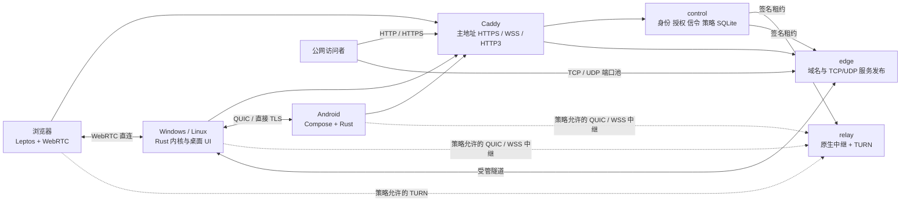

# NestLink 重构最终方案 v3

版本：3.0 · 日期：2026-10-12 · 状态：实施建议定稿，尚未执行重构

本方案综合《NestLink 全 Rust 统一内核完整开发方案》v1 和《NestLink 统一内核演进开发方案》v2，并核对当前正式构建入口、许可证文件和本次连接故障证据。本文独立定义完整方案，无需再以“沿用 v1”补齐要求。文中的技术路线是建议采用的实施基线；仓库操作、部署切换和数据处理均未执行。

## 1. 最终决定

建设一套以 Rust 共享业务内核为核心的新产品，在现有主仓库中形成 monorepo。保留品牌和现有视觉，重建连接、中继、隧道和平台适配；新体系与 14.x 硬隔离。开发过程中持续测试并完成内部技术验证，对外一次交付完整正式版本。

| 项目 | 最终推荐决定 |
|---|---|
| 产品版本 | 新体系首发建议为 **15.0.0**；14.1.0 保持独立维护版本身份，不能拿它承载不兼容重构 |
| 仓库 | 使用现有 `ZHanry/home-tunnel`，最终更名为 `ZHanry/NestLink`；三个组件仓库历史合并后保留旧发行，正式切换后归档 |
| 业务语言 | 服务端、身份、授权、策略、会话、连接调度、隧道、UI 状态、诊断和工程工具采用 Rust |
| 桌面界面 | egui/eframe 为首选，经桌面视觉、中文输入、无障碍和窗口行为关口确认；失败后按固定标准选择可合规分发的替代框架 |
| Android 界面 | **Jetpack Compose 薄界面 + Rust 状态与业务内核**，经 UniFFI/JNI 交互；不再把 Android egui 作为产品路线 |
| Web 界面 | Leptos + Rust/WASM，浏览器系统 API 使用 web-sys；复用经来源审查的品牌、CSS、文案和设计令牌 |
| HTTPS 入口 | 保留 Caddy，负责 HTTPS、ACME、管理 API/WSS 和公开 HTTP 服务入口 |
| 原生连接 | QUIC 直连；经策略允许可用 QUIC 数据报中继或 **443/TCP WSS 中继**；可达的直接 TCP/TLS 路径作为直连补充 |
| 浏览器连接 | WebRTC + STUN/TURN；单独验证 TURN/TCP、TURN/TLS，不能把原生 WSS 路线当成浏览器媒体兜底 |
| 路径默认值 | `deny / direct_only / disabled`；初始化提供清晰预设，管理员可明确启用自建中继 |
| 旧体系 | 新程序不依赖 hbbs、hbbr、frps、frpc、RustDesk、Go Agent、Node 服务或 Flutter 运行入口 |
| 许可证 | 推荐 **L-B**：新第一方代码 Apache-2.0；RustDesk 派生源码不进入新产物。旧历史保留原许可证，其他第三方按各自许可证处理 |
| 编解码 | VP8 作为互通基线，VP9/AV1 按实际能力和实时性选择，音频 Opus；第一方产物禁用 H.264/H.265/AAC/VVC |
| 切换 | 新账号、新设备身份、新配置空间和新数据库；不自动导入旧身份或授权，不自动销毁旧数据 |
| 发布 | 同一提交构建并固定全平台产物，完成安装、跨网、授权和媒体验收后发布一个正式版本 |

工作量不用于删减必选能力。技术验证失败要修复或采用已验证的替代实现，不能把必选能力变成占位页面。

## 2. 核对结果与对原方案的修正

### 2.1 当前代码起点

当前四仓的权威入口如下。仓库内旧文件可以提供设计和测试参考，但必须先核实是否进入当前正式产物。

| 组件 | 当前权威入口 | 重构时的用途 |
|---|---|---|
| 桌面 | Client 的 `client/` Rust/Flutter 工程、`build/ci/build-client.py`、`scripts/package-homedesk-windows.py` | 提取当前实际工作流、授权要求、视觉和安装行为；按来源选择可复用内容 |
| Android | `homedesk-core.lock.json` 固定的 Client 子模块及其 Flutter Android 工程；Android 当前 CI | 提取正式产品需求、权限和生命周期；根目录旧 `app/` Compose 工程仅作历史参考 |
| 服务端 | `control-center/`、`traffic-gateway/`、当前 compose 与 CI | 第一方业务逻辑和安全测试迁至 Rust；替换 hbbs/FRP 数据面 |
| 主仓库 | 四端发行组合、品牌、站点、材料核验和历史文档 | 作为新 monorepo 宿主，重写发行一致性规则 |

本次 14.1.0 工作树中的 UDP 补丁已通过隔离协议测试和加密 KCP 测试，尚未完成真实跨网验收与发布。它提供故障回归场景，不作为新 QUIC 内核已可用的证据。

### 2.2 必须修正的设计问题

| 原方案中的问题 | 最终处理 |
|---|---|
| v1 要完整开发后才验证，v2 引入关口 | 采用 v2 的持续测试和内部关口；完整产品仍需最终统一验收 |
| v2 对现有 Android Compose 和 Go GUI 的描述混入旧入口 | 以正式 CI、来源锁和打包脚本为准；当前 Flutter 页面补入工作流与视觉基线 |
| Android 全 Rust UI 与视觉/输入法/无障碍目标同时存在风险 | 直接采用 Compose 展示层，Rust 拥有业务状态；系统授权事实由 Android 提供 |
| WSS 兜底被容易理解成全平台媒体兜底 | WSS 中继适用于原生协议；浏览器 WebRTC 需要 TURN 可达，或另行验证额外方案 |
| 443 全归 Caddy，同时要求受限企业网络浏览器中继成功 | 默认保留主公网 IP 的 Caddy 443；受限网络可配置独立公网 IP/节点的 TURN/TLS 443 |
| TURN 短期 REST 凭证被当成实时撤销方案 | 凭证过期主要影响新认证，既有 allocation 必须主动回收并验证停止转发时间 |
| 高位端口被描述为无冲突、改善连通性 | 它们只是默认值；不保证未登记、未占用或企业网络放行，以实际 bind 和网络测试为准 |
| 100 个 TURN 端口与 1000 allocation 验收并列 | 端口池与 allocation 容量联动；默认扩大池，容量测试按实际分配资源另行配置 |
| `direct_only` 验收要求所有服务器转发为零 | 只约束远控路径；仅在 `server_forwarding=deny` 时要求全部用户业务转发为零 |
| 扫描不到 RustDesk 名称就证明无派生代码 | 来源台账、许可证审查和构建依赖审计是依据；字符串扫描只作辅助 |
| 整体仓库改名后旧 Pages 路径放跳转页 | GitHub Pages 的旧项目路径不保证继续可用；采用自有域名或单独可控的旧路径承载方案 |
| SVT-AV1/rav1e 等许可证被笼统归类 | 根据实际锁定版本、源码 LICENSE/NOTICE 和专利授权文件逐项登记 |

### 2.3 本次连接故障对新架构的要求

已观察到公司链路的异常 TCP RST，手机流量则能完成信令、随后 TCP 直连失败。关闭 Clash 没有恢复两组连接。旧客户端关闭了其他直连路线，对部分 NAT 标记只给 1 秒 TCP 超时；stock hbbs 与现代 UDP 扩展不兼容。

因此，新实现必须满足：

1. 控制面采用 HTTPS/WSS，并独立于 P2P 打洞成功与否；不再使用旧 hbbs 裸 TCP 信令。
2. 同一内核与协议源负责客户端和服务端能力协商，CI 测出双方实际可互通的字段和路径。
3. 使用 IPv4/IPv6、局域网、反射地址和已授权中继候选，按实际连通性检查选择路径。NAT 分类只用于诊断和调度，不能直接判定无法直连或缩短成 1 秒唯一尝试。
4. 系统网络变化触发候选代次更新，失效旧映射；不能把代理网卡或过去的映射当作当前宽带事实。
5. 在管理员允许时提供可靠的自建中继；管理员禁止中继时，按有界预算尝试直连并明确解释失败。
6. 真实公司→家里、手机流量→家里必须进入新版已安装产品的验收矩阵。

这些设计减少单一路线导致的失败；任何 P2P 算法都不能保证所有 NAT、防火墙和网络过滤组合可直连。

## 3. 产品范围与平台边界

| 产品 | 必选交付 |
|---|---|
| Linux x64/ARM64 服务端 | 账号/TOTP/恢复码、设备、审批与授权、信令、策略、节点、STUN/TURN、原生中继、HTTP/HTTPS/TCP/UDP 服务发布、配额、审计、加密备份恢复、升级与诊断 |
| Windows x64 | 主控/被控、多显示器、输入/音频/文件/文本剪贴板、设备和隧道管理、后台守护、托盘、安装升级卸载、诊断 |
| Linux x64/ARM64 | 同类客户端能力；分别交付 X11 和经过门户授权的 Wayland 适配 |
| Android ARM64/x86_64 | 账号、设备和隧道管理、主控、系统允许的被控、前台通知、本地停止、网络切换恢复 |
| Web | 管理与浏览器主控；真实画面、输入、音频、文件选择和受浏览器权限约束的文本剪贴板 |

远控保留本机批准、一次性授权、明确登记的受信设备访问及逐项权限。登录、设备归属、远控批准和服务发布权限分别建模。现有固定密码访问需求要重新建模为明确授权流程，并迁移防爆破测试，不能以知道设备 ID 替代授权。

Android 管理其他设备的隧道，不要求手机充当无人值守的常驻公网出口。其被控输入依赖系统无障碍授权，屏幕共享依赖有效 MediaProjection；一次系统同意不能无限复用。浏览器不做系统级被控。

不包含 macOS/iOS、内核 VPN/TUN、任意出口 SOCKS、安全桌面绕过、计费和插件市场。桌面安全锁、权限预设、空闲断开、来源限制等现有安全工作流必须逐项登记；其他历史功能先形成需求台账，明确首发范围，不能直接把所有旧菜单当作已承诺功能。

## 4. 架构与职责

### 4.1 服务端

一个 `nestlink-server` 二进制提供 `control`、`edge`、`relay` 角色；单机可组合启动，多节点可按角色独立部署。Caddy 是独立入口进程。控制中心为单逻辑实例，使用本机 SQLite；数据节点通过认证通道领取签名策略和短租约。

SQLite 数据文件仅由控制中心管理，不在多个节点或网络共享目录上共同写入。采用本地持久卷、外键/唯一约束、事务和经过压测的 WAL/检查点配置；备份使用一致性快照，不能直接复制仍在写入的单个数据库文件。



统一内核共享身份、授权、状态、错误和策略。QUIC、TLS/WSS、WebRTC 可以有不同线上封装，不能要求浏览器直接执行原生 QUIC 协议。

服务端进程边界为：控制中心处理账号和签发；转发节点执行策略、配额和连接回收；媒体编码、解码与输入在终端执行。中继不提供服务器媒体转码，不持有远控会话明文密钥。

### 4.2 桌面进程与退出行为

三个组件：普通权限 UI、本用户后台守护进程、最小接口的权限代理。网络解析和媒体处理不得全部放进管理员/System 权限进程。权限代理仅提供经授权的系统操作，不能提供任意命令执行。

Windows 必须采用用户已要求的行为：

| 操作 | 结果 |
|---|---|
| 最小化 | 常规任务栏最小化，保留任务栏入口 |
| 关闭主窗口 | 隐藏到托盘，现有授权内的远控/隧道保持运行 |
| 托盘打开 | 恢复同一主窗口；Explorer 重启后重建图标 |
| 托盘“退出程序” | 释放输入，关闭本用户远控和隧道，撤销其运行租约，退出 UI 与本用户守护进程；监督器不得立即重启它 |
| 托盘不可用 | 关闭操作保留可见入口并给出提示，不能留下无法恢复的隐藏窗口 |

如安装了系统权限代理，退出后它仅保持空闲且不继续本用户业务。开机/登录自启是独立设置，显式退出要持续到用户再次打开或下一次已配置的启动事件。注销账号和退出程序分别处理，保留或清除登录缓存按界面明确的选项执行。

关闭独立远控窗口只结束该远控会话并释放其输入；主工作台关闭到托盘与远控窗口结束分别处理。

Linux 按桌面环境支持实现任务栏/托盘入口；缺少托盘时要有可恢复入口和明确退出方式。

### 4.3 Android 和 UI 状态

Rust 拥有账号、设备、授权、会话、路径和恢复状态。Compose 接收不可变视图模型、发送带 ID 的用户操作，不另写一套权限或重连状态机。Kotlin 负责系统生命周期、MediaProjection、AccessibilityService、通知、文件选择、Keystore 和 Surface/MediaCodec 回调。

Android Keystore 和系统授权结果是平台事实，由平台桥返回真实成功/失败；Rust 决定该事实是否满足当前业务授权。Service 存活与 Activity 重建分开，后台被系统终止后不能假装共享继续运行。

## 5. Monorepo 与代码来源

### 5.1 目录统一

```text
NestLink/
  Cargo.toml  Cargo.lock  rust-toolchain.toml  deny.toml
  compatibility.json
  brand/  design-tokens/
  protocol-spec/                 # API、消息、能力、错误、测试向量，唯一权威源
  crates/
    protocol/ identity/ auth/ policy/ session/ storage/
    connectivity/ transport-quic/ transport-stream/ transport-webrtc/
    stun-turn/ relay/ edge/ tunnel/
    remote/ media/ codec/ input/ clipboard/ filexfer/
    platform-windows/ platform-linux/ platform-android/
    ui-model/ sdk/ ipc/ observability/
  apps/
    server/ desktop/ daemon/ privileged/ web/
  android/                       # Gradle + Compose + cdylib 绑定
  packaging/                     # Windows、deb、systemd、OCI、Caddy
  tests/
    vectors/ contract/ integration/ security/ network-lab/
    platform/ visual/ acceptance/
  xtask/  docs/  site/
  legacy/                        # 临时旧源码，永不参与新构建
  .github/workflows/
```

所有 Rust crate 属于一个 workspace。Android 直接引用 workspace 的 `path` 依赖，移除跨仓 gitlink 和 `homedesk-core.lock.json`。crate 在拥有明确接口和实现时建立，避免只有空壳的目录数量成为进度指标。

`protocol` 不依赖数据库或 UI；`policy/session` 不依赖具体传输；平台库不签发业务权限；UI 只通过 SDK/IPC 使用业务模型；共享库分别适配 native 和 WASM，浏览器构建不能拉入 Tokio 网络、SQLite 或桌面系统依赖。

### 5.2 历史并入

在临时本地克隆中对三个组件仓库执行历史审计，再用 `git filter-repo --to-subdirectory-filter legacy/<component>` 加 merge，路径从一开始就固定为 `legacy/server`、`legacy/client`、`legacy/android`。记录原提交到新提交的映射；旧 tag 加组件前缀，避免版本冲突。原仓库不改写历史、不强推。

大文件先分类：发行二进制移至历史材料存档；必要源码、许可证、构建配方不能因体积一刀切删除。若历史存在秘密，先处理失效/轮换和披露范围，再决定可公开导入的引用；忽略规则不能把秘密变成可发布数据。

新代码始终独立于 `legacy/` 构建。模块迁完并审查后移除其临时旧源码；首发工作树中清空 `legacy/`，历史仍可查询且保留各文件许可证。

主仓库更名、保护规则、GHCR、OIDC 签名身份、Pages、自有域名和下载链接作为一个变更清单核验。保留旧 tag/Release 和原下载字节。旧名称在历史材料中可存在，扫描只阻断新运行依赖和活动配置中的遗漏。

### 5.3 许可证与复用规则

采用 L-B 时，可迁移经确认由项目拥有权利的 Go/TS/Kotlin/C++ 业务、契约语义和测试资产；RustDesk 派生 Rust/Dart/平台模块不得通过复制、机械翻译或改名进入新产物。UI 外观依据经审查的自有设计、品牌资产和真实截图独立实现。

每个来源登记原仓库/提交/文件、许可证、修改方式、新位置和审查结果。涉及第三方测试向量、生成代码、字体、图标和构建补丁，也要登记。采用 Apache-2.0 不会自动改变混入的第三方许可。

第三方 FFI 和独立服务允许存在，包括系统 API、libvpx、Opus、AV1 实现、必要时的 libwebrtc/coturn/Caddy。它们不持有第二套业务授权。锁定依赖和特性，用 cargo-deny/cargo-about 加非 Cargo 依赖台账生成完整 SBOM/NOTICE；Rust 字符串扫描不替代来源审查。

## 6. 协议、身份与授权

### 6.1 契约

原生应用协议标识 `nestlink/1`，管理 API 路径 `/api/v3`，OpenAPI 规范格式采用 3.1。产品版本、API 版本、传输 ALPN 和消息 schema 版本分别定义，不能互相替代。

管理 API 使用 JSON；结构化原生消息首选 Protobuf/prost，禁止把 Rust 内存布局直接发送到网络。`protocol-spec/` 保存模式、长度预算、错误码、幂等语义与测试向量；xtask 生成 Rust、OpenAPI、必要的 Kotlin/Web 绑定并检查漂移。

旧 24 字节帧头和输入 epoch 语义作需求参考；新协议明确重建，线上不得自动回退旧 RustDesk/hbbs/FRP/API。先合并四仓契约并列出差异，按实际功能审查处理，不能仅复制 server 的 OpenAPI 就认为差异全部消失。

握手至少绑定：部署 ID、协议版本、会话 ID、双方身份、公钥/证书摘要、资源、权限、路径约束、策略代次、连接代次、过期时间和能力摘要。未知必选能力明确拒绝；未知可选字段有固定处理规则。敏感操作禁用 0-RTT。

### 6.2 密钥与许可

每个安装实例生成新身份。账号会话、设备凭据、节点身份、策略签名和更新签名使用不同密钥与用途。设备注册证明密钥持有权；浏览器使用会话临时密钥/证书，不能仅凭 ID 发起控制。

控制中心签发受资源与权限限制的会话许可，端点握手证明持有与许可匹配的密钥。QUIC/直接 TLS 的证书验证同时校验预期公钥绑定和 TLS 签名，禁止“接受任意证书”回调。浏览器 SDP 中 DTLS 指纹经会话许可和端点证明绑定，防止中继替换对端身份。

允许的路径集合取各层策略交集：全局、账号、设备、资源、会话以及双方本地限制。`direct_only={direct}`、`direct_preferred={direct,relay}`、`relay_only={relay}`；交集为空就拒绝，不能用枚举大小或字符串比较决定权限。

使用成熟密码实现与系统安全存储。TOTP 密钥加密保存，恢复码哈希且一次消费；账号令牌刷新沿用当前已验证的代次隔离要求。更新/备份密钥和配置不进入诊断明文。

### 6.3 持续授权

默认节点策略租约 10 秒、每 3 秒续租；会话授权租约 15 秒、每 5 秒续租。在线撤销目标为 2 秒内停止敏感业务；失联时按当前剩余租约停止。收到租约后使用单调计时，墙钟倒退、系统休眠和旧响应都不能延长授权。

撤销事件同时取消监听、数据转发、文件写入、输入和队列，释放按键；恢复时必须获得当前有效授权。数据库恢复生成新的安全代次，使备份前的旧票据无法复活。控制中心失联后不提供永久离线远控。

本机 IPC 使用 OS 端点 ACL、调用方身份和有界协议，按命令授权；禁止来自 UI 的任意路径加载、任意进程启动或任意高权限操作。

### 6.4 新数据模型

新模型至少包含：部署、安全代次、账号/角色、安装设备、能力声明、分用途凭据、会话许可、连接代次、服务发布、节点、allocation、策略版本、租约、配额和审计。

每个安装实例只有一个权威设备 ID，远控与隧道是该设备的不同能力/资源；前台登录和后台服务仍使用分用途凭据及独立撤销范围。不得按名称、IP 或不可靠硬件指纹合并设备；重装生成新身份，明确解绑旧实例。整机撤销在一个事务内使其能力、凭据与租约失效，撤销前台管理会话只影响明确属于该会话的授权。

会话批准、服务归属、端口预留和配额变更有明确事务与幂等边界。节点用序号/代次上报计量，避免重试重复扣费或重复释放容量；节点重启和恢复不能把已撤销资源重新标成可用。审计只记录必要元数据，配置保存期限并执行有界清理。

## 7. 连接与中继：解决实际连通性

### 7.1 原生直连

连接模块监听系统网卡/默认路由变化，用同一 UDP endpoint 完成地址探测、映射创建和 QUIC 路径检查。新网络生成新候选代次；代理、Wi-Fi/流量切换、IPv6 地址变化、休眠恢复均要重测。

并发检查允许的局域网 IPv4/IPv6、反射地址和可达 TCP/TLS 候选。IPv6 使用平台能力、真实路由和防火墙结果，不全局硬禁用；局域网候选不得越过账户/资源/地址策略。TCP 打洞可作为补充，不能成为所有网络的唯一前提。

候选只能指向已授权对端和用途，校验地址归属、协议和端口，限制探测数量与速率，阻止云元数据、环回、管理网和任意 SSRF 目标。具有多个映射时保留具体端点与探测结果，避免一个 NAT 标签掩盖实际差异。

建议初始调度：`direct_preferred` 的直连检查预算 2 秒后启动中继，并继续受控竞速；`direct_only` 总预算默认 12 秒且可配置。3 秒/8 秒的 P95 是固定可达网络矩阵的验收目标，不能据此承诺所有失败在相同时间内结束。

### 7.2 原生中继与端到端加密

两条路径统一受 relay 分配和权限约束：

- **QUIC 数据报中继**：端点与节点建立外层受控连接，节点按 allocation ID 转发内层端点 QUIC 包；内层 QUIC/TLS 由双方终端终止。节点不能解密远控业务。虚拟 UDP 适配、MTU、拥塞和路径迁移在技术关口验证。
- **WSS 字节流中继**：双方通过 Caddy 的 443/TCP 建立外层 WSS，relay 配对有授权的字节流；字节流内部再建立双方终止的 rustls TLS 安全通道，绑定相同许可和身份。Caddy/relay 只看到密文与流量元数据。

WSS 能在 UDP 被阻断时提高原生可达性，但不能绕过禁止中继的策略，也不能保证企业代理必然放行长期 WebSocket。经 WSS 的媒体必须显示流通道降质状态，不能承诺 UDP 的延迟表现。

`relay_only` 不发起对端直连检查；`direct_only` 不申请任何用户负载中继。换路径或重建连接生成新连接代次、释放输入、重新核对许可，不重放旧控制消息。

### 7.3 浏览器的实际兜底

WebRTC 使用标准媒体轨道与 DataChannel。禁中继同时要求：不下发 TURN 凭证、不接受 relay 候选、检查实际 selected candidate pair，以及服务端拒绝分配/转发。浏览器标准仅有 `iceTransportPolicy=all/relay`，没有 `direct_only`。[S1]

TURN/TCP 和 TURN/TLS 使用专用监听。HTTPS WSS 不等于 TURN，普通 Caddy HTTP reverse_proxy 不能直接接收 TURN/TLS。最终提供两个明确部署档位：

| 部署档位 | TURN 入口 | 受限网络边界 |
|---|---|---|
| 标准单 IP | 高位 UDP/TCP 与 TURN/TLS 高位端口；主 IP 443 由 Caddy 独占 | 仅允许 TCP 443 的网络，浏览器 WebRTC 可能失败；原生可按策略尝试 WSS |
| 企业网络档 | **另一个公网 IP 或数据节点的 TURN/TLS 443**；主控制域的 443 仍由 Caddy 使用 | 浏览器必须实测该固定版本与节点的 TURN/TLS 443 可达；显式 HTTP 代理环境另列结果 |

独立 IP 的 443/TCP 是必要的部署例外，不能坚持所有 IP 的 443 都只能由 Caddy 使用，同时承诺浏览器在所有仅 443 网络可用。单 IP 的 L4 复用若未来采用，需要固定的 Caddy layer4 插件、原始 TLS 分流、真实浏览器和证书测试；它不进入首发默认方案。[S2]

浏览器失败要返回 `TURN_UNREACHABLE` 等具体原因并展示所需入口，不能悄悄改走一套未验收的 WSS 媒体协议。

### 7.4 TURN 实现及撤销

优先采用 Rust STUN/TURN 标准库并补齐受管 allocation 策略。浏览器端到端保护仍由 DTLS-SRTP/DataChannel 提供；TURN 不解码媒体。

allocation 绑定会话、临时身份、目的端点、用途、代次、租约和限额。检查 Allocate、Refresh、CreatePermission、ChannelBind 与实际转发点，阻止通用公网代理、扫描内网和未授权 peer。停止时删除 allocation/permission/channel 并清空队列。

coturn 仅在其适配通过完整关口时作为独立标准依赖备选：证明能限制 peer、主动关闭既有分配、在负载下 2 秒内停止转发、失联按短租约关闭。**只配置 REST 共享密钥和短期用户名不满足这些要求。** 若备选不能达到要求，就继续完善 Rust 实现，不能豁免中继策略。

## 8. 转发策略、隧道与端口

### 8.1 三项策略与合法组合

| `server_forwarding` | `peer_path_mode` | `public_ingress` | 结果 |
|---|---|---|---|
| deny | direct_only | disabled | 合法：仅设备直连，控制/信令/STUN/下载仍可用 |
| deny | direct_only | enabled | 拒绝：公网服务需要用户业务转发 |
| deny | direct_preferred / relay_only | 任意 | 拒绝：请求了被总开关禁止的路径 |
| allow | direct_only | disabled / enabled | 合法：远控仅直连，公网隧道独立开关 |
| allow | direct_preferred | disabled / enabled | 合法：直连优先，中继可用 |
| allow | relay_only | disabled / enabled | 合法：远控强制中继 |

原子提交完整配置，产生 `policy_revision`。新违规请求立即拒绝，已有业务按在线撤销/租约上限停止。管理台显示目标版本、节点已应用版本和失联租约截止；只有完成执行或确认租约过期后，才显示全部生效。

`server_forwarding=deny` 时，管理流量不为零，但用户媒体、文件、输入、原生中继、TURN 和公网隧道转发计数必须为零。`allow+direct_only+enabled` 可以有隧道流量，远控中继计数仍必须为零。公开任意 TCP/UDP 服务时，系统无法仅凭内容证明用户不会运行其他远控协议。

### 8.2 隧道

HTTP/HTTPS：Caddy 按已授权域名把请求送到 edge，edge 核对当前服务 ID、访问限制与配额，经受管隧道送达本机已批准的目标。配置变更和注销撤销后停止新接入与既有转发。WebSocket、流式响应、上传、超时和背压均需实测。

TCP/UDP：edge 直接管理端口池。TCP 支持半关闭、独立流预算、超时；UDP 保留数据报语义，限制 MTU、映射寿命、重组和速率，不能放入无限可靠队列。UDP 经 TCP/WSS 承载时明确标注可靠流导致的延迟和队头阻塞，若服务要求原生数据报则按能力拒绝。

设备只连接本地已批准的地址和端口，服务端不能单凭配置任意探测客户端内网。域名所有权、Host/SNI、DNS 重绑定、访问 ACL 和资源归属逐项校验。

L7 HTTPS 在 Caddy 终止，文档明确服务器可见业务明文。首发 L4 业务 TLS 透传由 edge 在独立分配的 TCP 端口完成，业务 TLS 由访客和内网服务终止；不宣称同一 Caddy 443 同时自动提供任意 SNI 透传。[S2]

### 8.3 端口配置

| 默认监听 | 所有者 | 用途与开放条件 |
|---|---|---|
| 主 IP 80/TCP | Caddy | HTTP-01 与跳转；采用 DNS-01 且不需要跳转时可关闭 |
| 主 IP 443/TCP | Caddy | 管理 HTTPS、信令、原生 WSS 中继入口、公开 HTTP 服务 |
| 主 IP 443/UDP | Caddy | HTTP/3；阻断后管理网页应回落 TCP |
| 28743/UDP | Rust relay/edge | 原生外层 QUIC、隧道和探测；deny 下仅保留经配置允许的探测 |
| 28744/UDP+TCP | STUN/TURN | 探测与 TURN 接入；禁止中继时可只提供 STUN |
| 28745/TCP | TURN | TURN/TLS，独立证书和续期部署机制 |
| 28800–29055/UDP | TURN | 默认 256 个 relay 端口；按实际 allocation 容量扩容 |
| 29100–29199/TCP+UDP | edge | 按服务分配的公开端口，公开入口启用时才开放 |
| 可选独立 IP/节点 443/TCP | TURN | 企业网络档 TURN/TLS；不占主 IP 的 Caddy 监听 |
| Unix socket/内部网络 | 内部控制 | Caddy Admin、角色间管理；不向公网开放 |

所有业务端口可配置，客户端从认证控制面获取端点，不手填服务器内部参数。TURN/TLS 证书由受控的证书供应流程交付，Rust 不重写 ACME；Caddy 管理入口的 HTTPS 证书不能自动视为 TURN 进程已经获得证书和私钥。

默认端口用于减少常见冲突，部署必须同时核对 IPv4/IPv6、Docker/宿主机映射、防火墙、云安全组，并以实际独占 bind 判定可用。预检 `ss` 无法消除启动时竞态。关闭角色应关闭对应业务 listener；STUN、QUIC 探测与用户负载转发分别统计。

TURN 一个 allocation 消耗的端口/套接字由实际实现确认。1000 allocation 测试需足够可分配资源，例如单独配置 30000–31535 并做冲突核验；默认 256 端口池不承诺 1000 allocation。100 路会话的双方 allocation、地址族和保留资源一起计入容量。

部署包提供按角色生成的防火墙规则和配置预览，不自动放开未启用的整段端口。Caddy 的低端口权限与 Rust 数据节点的权限分别配置；数据节点使用非 root、只读文件系统和必要最小能力。

## 9. 媒体、输入与视觉

### 9.1 编解码

所有被控端先提供可靠的 VP8/Opus 基线。选择编码器时同时检查双方协商能力、真实 encoder/decoder、低延迟性能与当前资源；不能固定按 AV1→VP9→VP8 顺序盲选。

VP9/AV1 用于通过矩阵的设备；软编 AV1 未达实时目标时选择 VP8/VP9。MediaCodec、Media Foundation、VA-API 或厂商 SDK 的“支持”必须区分编码与解码，完成实际格式初始化和持续输出；不能根据 GPU/SoC 名称推断可用。

第一方原生能力列表与 WebRTC offer/answer 禁用 H.264/H.265/AAC/VVC。libwebrtc 如作为备选，其构建特性、依赖和运行协商都要验证。用户已有浏览器内置其他 codec 无法由 NestLink 删除；验收范围是 NestLink 分发的代码、依赖及实际协商。

VP8 可作为浏览器互通基线，但仅提供 VP8 的实现不能宣称满足 RFC 7742 的全部强制编解码要求，RFC 同时规定 VP8 和 H.264；本产品是有意采用受限 codec profile 的 WebRTC 互通实现。[S3]

VP8/VP9/AV1/Opus 采用相应开放授权实现，准确表述为减少专利与许可负担，不能承诺零专利风险。锁定版本的许可证、专利许可和厂商 SDK 条件纳入来源材料。

### 9.2 媒体与输入通道

控制/撤销、输入、音视频、文件/剪贴板使用独立预算和队列。过期视频帧丢弃，文件流背压，音频有界缓冲；编码使用专门工作线程/池，不能阻塞 Tokio I/O。默认每帧重组上限 8 MiB，控制消息 256 KiB，输入消息 16 KiB，文件块 64 KiB；正式预算在协议冻结时结合分辨率和压测确认。

网络恢复、显示器切换、控制权交接、锁屏和退出先释放所有按键。输入事件绑定 input/layout/connection epoch；可靠按钮消息携带对应坐标。中文输入区分键盘事件和文本提交，文本提交带幂等 ID，避免按键与文本双重输入。

文件写入限制到用户选定范围，拒绝路径穿越、符号链接/reparse point 越界；校验完成后发布文件。续传重新获得当前授权，不重放旧会话消息。剪贴板读写分别授权，失败显示准确原因。

### 9.3 平台能力

Windows 采用系统采集/音频/输入接口，明确用户会话、完整性等级、UIPI 和安全桌面边界。Linux X11 和 Wayland 分别适配，Wayland 通过 portal + PipeWire；GNOME/KDE 目标版本必须实际验证，wlroots 按具体 compositor/portal 固定能力，不能统一声称全部支持。

Android 真机验证旋转、Activity 重建、Service 停止、锁屏、网络切换、MediaProjection 撤销、音频限制和权限拒绝。浏览器剪贴板/文件/输入能力受安全上下文和用户授权约束。

### 9.4 视觉基线

保留 NestLink 图标、紫色品牌、明暗主题、三个业务导航、账号入口和现有布局。桌面主工作台以 1120×760 设计尺寸为基线，适配可用屏幕和 DPI；远控窗口保留全屏与独立窗口行为。

从经审查的品牌、Flutter/CSS/历史主题提取设计令牌，生成 egui、Compose 与 Web 使用的颜色/字号/间距/圆角定义。截图基线选择实际当前正式应用，历史 Go/Compose 截图单独标注；预览截图不能代替已安装产品视觉验收。

验证主要页面的中/英文、明/暗主题、窄屏、100%/125%/200% 缩放、键盘导航、中文输入和屏幕阅读。按平台字体渲染设置比较容差，动态文本单独遮罩；结构、尺寸、品牌或交互差异逐条登记。字体来源和分发许可证固定。

## 10. 技术验证关口

关口是内部工程验证，不对外发布 MVP。表中时间为建议时间盒，不是整体工期承诺；到期提交结论和原件，不能无证据宣布通过。可复用合规实现，但每个替代仍须达到同一业务与安全标准。

| 关口 | 建议时间盒 | 通过条件 | 未通过处理 |
|---|---|---|---|
| G0 来源与产品基线 | 1–2 周 | L-B 来源台账、允许依赖、平台/浏览器版本、APK 分发、签名方案和需求台账冻结 | 先解决来源或分发问题；不迁入权利不明代码 |
| G1 浏览器媒体 | 4 周 | webrtc-rs 与固定 Chrome/Edge/Firefox：VP8 1080p30 30 分钟、Opus、输入/文件、NACK/PLI/拥塞、重连；其他 codec 按能力验证 | 使用经审查的 libwebrtc FFI；仍由 Rust 处理授权和会话；不双引擎运行时隐式切换 |
| G2 TURN | 3 周 | UDP/TCP/TLS 接入、负载/端口预算、未授权 peer 拒绝、在线 2 秒主动撤销、失联到期关闭、24 小时协议模糊测试 | coturn 适配达到全部要求才能替代，否则继续完善 Rust 实现 |
| G3 桌面 UI | 3 周 | 现有视觉、中文 IME、多窗口、DPI、无障碍、视频纹理、最小化/托盘/退出在 Windows/Linux 成立 | 选择通过相同矩阵且许可证可接受的替代；Android 保持 Compose 路线 |
| G4 平台采集输入 | 3 周 | Windows、Linux X11、固定 GNOME/KDE 及 ARM64 Android 的真实系统能力与恢复流程 | 解决适配；真实 OS 限制进入预先固定的矩阵，未实现不能写成不支持 |
| G5 连接与密文中继 | 3 周 | NAT/IPv6/代理网卡变化；内层 QUIC 经中继；UDP 阻断后原生 WSS；TURN/TLS 443 企业档；策略/密钥绑定无绕过 | 修复或采用标准库适配，保留正确失败；不能下调必选授权和中继语义 |
| G6 编码实时性 | 2 周 | 参考 CPU/GPU 持续 1080p30，延迟/CPU/温度/码率有实测；各平台至少一种基线达标 | 使用通过验证的 VP8/VP9，AV1 仅在通过的能力上启用 |

网络实验室冻结拓扑：单/双层 NAT、端点依赖映射/过滤、IPv6、UDP 阻断、仅 TCP 443、移动网络切换、代理网卡、丢包/乱序/MTU。可直连拓扑至少 100 次连接检查，成功率目标 ≥99%；不可直连拓扑要求正确失败或按允许策略中继。公司和运营商真实环境单列，不能用实验室成功率推算其结果。

## 11. 实施顺序与完成定义

| 工作包 | 结果 | 依赖与内部完成条件 |
|---|---|---|
| P0 基线与仓库 | 当前产物/需求/测试/视觉/许可证台账，历史导入、workspace、CI、协议源 | G0；旧运行入口与新构建隔离；保留原失败证据 |
| P1 安全与数据 | identity/auth/policy/session/storage，新初始 schema、TOTP、恢复码、签名租约 | P0；授权、幂等、重放、账号切换、旧代次和恢复失效测试通过 |
| P2 控制与连接 | Axum control、Caddy、候选/QUIC/直接 TLS/WSS、节点注册 | P1 + G5；端到端身份与路径策略成立，有界恢复和诊断可用 |
| P3 数据面 | relay、STUN/TURN、edge、公网隧道 | P1/P2 + G2；策略组合、运行中撤销、端口/配额/半关闭/背压通过 |
| P4 远控与平台 | 媒体/输入/文件/剪贴板及 Windows/Linux/Android 适配 | P1 + G1/G4/G6；真实采集、编码、输入与权限生命周期通过 |
| P5 产品 UI | 桌面、Compose Android、Leptos Web，SDK/IPC/诊断 | P2–P4 + G3；全部必选页面与真实状态工作流，视觉矩阵通过 |
| P6 安装运维 | Windows/DEB/APK/OCI、升级回滚、证书、备份恢复、签名 | 可随前述工作推进；完整新装和新体系内升级/卸载可用 |
| P7 全量提测 | 从同一干净提交构建全部产物并固定哈希，执行完整验收 | 所有工作包完成；缺陷修复改变字节后重建并复验受影响范围 |
| P8 正式切换 | 一次正式 Release、站点与升级元数据、部署说明和旧仓归档 | 必选验收通过、签名与下载验证、停用/回滚演练完成 |

服务端迁移按业务域进行：账号与安全、设备与能力、许可与信令、策略/配额/审计、服务发布、备份运维。旧 SQL 的约束和索引可作参考，新库使用新的初始迁移，不重放旧库升级链。现有 security/account/native/browser/tunnel 测试按需求迁移；断言只能根据明确的新契约修订。

完整开发完成要求：真实 UI、服务、协议、平台后端、安装包、配置模式、运维和测试程序全部可用；无占位必选能力、旧引擎 fallback 或默认关闭的空实现。语言改写比例、目录数量、编译成功均不能代替结果。

## 12. 验收与性能

### 12.1 必选验收矩阵

| 编号 | 必须验证的结果 |
|---|---|
| A01 | 全平台真实新装、新账号、新设备；新命名空间不读取旧配置，Android 新 applicationId 与旧包独立 |
| A02 | 旧 API、旧票据、旧 hbbs/RustDesk/FRP 入口拒绝；产物不存在旧运行依赖 |
| A03 | Windows/Linux/Android 的主控与被控组合，Web→各被控平台按固定 OS 能力矩阵完成真实画面、输入和已授权附加通道 |
| A04 | `deny` 下全部用户业务转发为零；`allow+direct_only` 下远控中继为零且允许的隧道正常；用节点计数/端点信息/抓包交叉核对 |
| A05 | direct_preferred/relay_only 的实际路径、节点、流量与界面一致；强制中继不尝试直连 |
| A06 | 运行中禁用/撤销：在线目标 2 秒内停止；失联按租约停止；输入释放，队列与 allocation 清理 |
| A07 | QUIC、TLS/WSS、TURN 各路径的权限、租约、配额和撤销一致，不存在旁路 |
| A08 | 越权、错误密码/批准、重放、令牌刷新、账号切换、设备移除、旧代次和过期许可均不能恢复权限 |
| A09 | 网络实验室与真实公司→家里、手机流量→家里；Clash/TUN 开关、网卡切换、IPv4/IPv6、UDP 阻断、仅 443、丢包/乱序/MTU |
| A10 | HTTP/HTTPS/TCP/UDP 隧道：授权目标、域名、ACL、配额、流式/WebSocket、半关闭、UDP 映射和撤销 |
| A11 | 多屏/DPI/布局/IME/音频/旋转/休眠；Android 系统授权与停止；Linux portal；硬编失败的软件恢复 |
| A12 | 文件路径与符号链接安全、校验/续传、剪贴板授权；大文件不阻塞撤销和输入 |
| A13 | 控制/节点崩溃重启、断网、磁盘满、证书失效/续期、时钟回拨、备份恢复、旧租约失效 |
| A14 | 解析/网络/IPC 模糊测试、预算与内存有界、SSRF/DNS 重绑定、跨账号、FFI/unsafe 审查、凭据脱敏、供应链 |
| A15 | 固定环境容量/延迟/吞吐和 72 小时稳定性；无授权复活、持续内存增长、无法回收的会话 |
| A16 | 第一方依赖、二进制和实际 SDP/协商无禁用 codec；浏览器内置能力与 NestLink 使用能力分别记录 |
| A17 | 各固定浏览器/平台/ABI 的真实 codec、软硬编、格式、实时性、降级和失败提示与能力矩阵一致 |
| A18 | L-B 来源审查、第三方完整 LICENSE/NOTICE/SBOM、对应构建材料；历史许可证保留；无未经允许的派生代码 |
| A19 | Caddy ACME/HTTP3/TCP 回落、Cookie 域隔离、Admin 不暴露；端口变更/冲突/防火墙一致；TURN/TLS 证书与企业档可用 |
| A20 | 当前正式视觉基线、主题/语言/DPI/窄屏/无障碍；窗口最小化、关闭到托盘、退出清理和 Explorer 重启 |
| A21 | Windows Authenticode、APK 证书、Linux/OCI/更新签名、旧签名/回滚攻击拒绝；新体系内升级和失败回滚 |

平台不支持的 OS 能力在 G0/G4 固定，给出版本与事实依据。ARM64 真机、移动流量和 72 小时稳定性不能由模拟器、单元测试或历史报告替代。必选项不能记 `not_run` 后仍宣称正式验收通过。

### 12.2 建议基准

性能目标在 G0 固定设备型号、版本、codec、链路和统计口径后生效。参考服务端为 8 vCPU/16 GiB，实验链路 10 Gbps；媒体参考 1080p30、RTT≤30 ms。当前 158.180.81.141 的实际容量须单独测试，不能套用参考机器指标。

| 指标 | 目标与测量口径 |
|---|---|
| 控制容量 | 1000 在线设备；登记、心跳、续租和管理 API 同时有规定负载 |
| 中继容量 | 100 路 × 8 Mbps；入站和出站各约 800 Mbps，分别记录链路、协议与 CPU；TURN allocation 数另计 |
| 直连建连 | P95≤3 秒：从批准完成到身份验证后的数据通道可用，仅统计固定可直连拓扑 |
| 中继建连 | P95≤8 秒：含有界直连尝试，按 QUIC/WSS/TURN/TLS 和网络档位分别记录 |
| 输入到画面 | P95≤150 ms：事件/画面标记测量；网络 RTT 不作替代 |
| 管理 API | P95≤200 ms：固定负载下普通请求，密码派生、导出和长任务单列 |
| 在线禁用 | ≤2 秒：控制链路正常且在规定负载内；已进入网络的数据无法撤回 |
| 失联策略/会话 | 分别不超过当前 10 秒/15 秒租约剩余寿命；休眠和重启不得重新开始旧期限 |
| TCP 隧道吞吐 | ≥同环境同加密基准的 70%；单流/并发分开，WSS/UDP/HTTP 分开报告 |
| 长期稳定 | 72 小时完整产品运行，周期执行连接、撤销、网络变化和流量；资源回收有记录 |

低端 Android 的温度/续航、软编 AV1 和高 RTT 网络单列，不混入基础延迟承诺。没有实测前不填写预计 SHA、成功率或性能结论。

### 12.3 原件与通过标准

每个用例绑定需求 ID、源码 SHA、构建配方、包哈希、环境、开始/结束时间、实际路径、日志/指标/抓包/截图原件及其摘要。原失败尝试保留，修复后的证据单列；工具返回零和截图完成不等于真实功能通过。

必选场景全部通过，无未处置的阻断/严重缺陷。授权、密钥、撤销、文件安全、更新签名、许可证和禁用 codec 相关失败不能豁免。依赖公告逐项评估和处理，不通过改名/批量忽略消失。

## 13. 构建、发布与切换

### 13.1 构建和材料

固定 Rust/JDK/Android SDK/NDK、系统编译器、codec/WebRTC 来源、Cargo.lock、插件和容器 digest。Rust/WASM/Android/桌面特性分别审计，不能在某个 ABI 中意外重新链接禁用组件。Node 若用于静态资源构建工具链可登记，不能成为产品服务运行依赖。

PR 无发行私钥。CI 有格式/静态分析、授权性质测试、协议/模糊测试、平台构建、依赖/secret/license 和安装检查。路径过滤用于开发提速；正式发布必须从同一提交执行全目标完整 gate，不把跳过任务标成完整通过。

先构建候选并保存不可变字节，基于这些字节完成安装验收；正式 Release 提升原产物，签名/打包改变字节时固定最终字节并重新核验相关安装与验收。发布材料关联同一源码提交、工具链、来源、SBOM、哈希、签名和证据索引。

Windows 安装器/可执行文件使用 Authenticode，APK 使用新 applicationId 对应的固定新证书；Android ARM64/x86_64 产物核对签名、ABI 和系统页大小要求。Linux/OCI 与更新元数据独立签名。Sigstore 来源证明不能代替平台代码签名。

### 13.2 旧体系停用与回滚

先并行部署隔离的新实例，完成新账号/设备/服务验证；不直接覆盖现有 `/opt/home-tunnel-server/v14.0.1` 或身份卷。Windows 本机旧产品如需安装清理，继续按现有已规定的清装脚本备份核验，新安装命名空间单独处理。

正式切换前导出旧配置的可读记录供用户手动重建；不自动导入数据库、旧凭据或旧设备授权。用户明确选择旧版停用和卸载，新客户端不自动删除旧数据。旧备份离线只读保留，可按明确保留期另行销毁。

失败回滚是重新启用完整隔离的旧环境，不把新数据库或新票据塞回旧服务。演练验证端口、域名、设备归属和安全代次；先停止新业务再切回，避免两个实例同时接受相同服务入口。

新版 Release、下载站、安装文档和恢复说明完成后再归档三个旧组件仓库。旧 tag/Release/下载保持可读。仓库更名或归档的确认节点属于实际执行阶段，本文没有执行这些操作。

当前 14.1.0 修改保留在原工作树，不合并到重构产物；是否继续发布该维护版由后续明确任务决定，本次只交付方案。

## 14. 首批实际工作与最终交付

开始实施时首先完成：

1. 以当前正式产物建立功能/安全/视觉台账，区分活动代码、历史代码和未验证能力。
2. 完成 G0 来源与分发基线，固定 L-B 允许清单、签名入口和首发平台版本。
3. 导入历史到临时本地分支，建立 workspace、唯一协议源和材料格式，不改生产。
4. 实现身份、许可、策略交集、租约与撤销，再做 QUIC/WSS/WebRTC/TURN 的真实互通关口。
5. 将公司/手机到家里的失败条件固化为测试案例，验证 direct_only 正确失败与允许中继后的恢复。

最终交付：一个 monorepo、一个正式版本的全平台产物、Web 资源、Caddy/OCI/systemd 模板、协议与配置模式、需求与能力矩阵、来源/SBOM/NOTICE、签名和更新材料、部署/旧版停用/回滚/备份文档、G0–G6 结论和 A01–A21 完整验收原件索引。

## 附录 A：配置示意

以下为设计示例，不是当前可直接运行的配置；正式实现提供机器可验证 schema。

```toml
[network]
server_forwarding = "deny"
peer_path_mode = "direct_only"
public_ingress = "disabled"

[policy]
node_lease_seconds = 10
node_refresh_seconds = 3
session_lease_seconds = 15
session_refresh_seconds = 5

[ingress]
management_origin = "https://console.example.com"
service_domain = "*.svc.example.com"
caddy_admin = "unix:/run/nestlink/caddy-admin.sock"

[quic]
listen = "0.0.0.0:28743"
advertised_port = 28743

[stun_turn]
listen = "0.0.0.0:28744"
tls_listen = "0.0.0.0:28745"
relay_ports = "28800-29055"
# 企业档可发布另一个公网 IP/节点的 turns:turn.example.com:443?transport=tcp

[edge]
public_ports = "29100-29199"

[media]
allowed_video_codecs = ["vp8", "vp9", "av1"]
allowed_audio_codecs = ["opus"]
selection = "measured_capability"

[connectivity]
direct_only_budget_ms = 12000
relay_start_after_ms = 2000
```

错误契约至少区分：`PROTOCOL_MISMATCH`、`AUTH_REQUIRED`、`PERMISSION_REQUIRED`、`DIRECT_UNAVAILABLE`、`RELAY_DISABLED`、`TURN_UNREACHABLE`、`PUBLIC_INGRESS_DISABLED`、`POLICY_REVOKED`、`LEASE_EXPIRED`、`CAPACITY_EXCEEDED`、`CODEC_UNSUPPORTED`、`PLATFORM_UNSUPPORTED`、`OS_PERMISSION_DENIED`。实际路径失败保留阶段与底层原因，不能全部归成 NAT/防火墙或“网络错误”。

## 附录 B：来源与核对范围

输入文件 SHA-256：

- `nestlink-plan-v2.md`：`f24dfa87f37ec027febab8841bcc04f7335859ce4ffaaba0131bb132ad40bfe5`
- `NestLink_Rust_Unified_Core_Plan.md`：`606982412b73c928b7bf6eccdd587e3581928207dae699ba5a296376ca18c26b`

本次读取的工作树基础提交：Hub `da66975153385f9d92643daa4b7d9f1efbaa7a7d`；Server `10d3f5be070b4caf4d8feb11defb86ad0e68e5d4`；Client `181519880a5971f0618adfc81a55281a09d613a8`；Android `fc3690289d7bda0b0f0aec122e9379b2fa93f16c`。Client/Server 同时存在未提交的 14.1.0 修改，本文没有把其工作树等同于正式已发布源码。

本地事实依据：Android `docs/BUILDING.md`、`homedesk-core.lock.json`、当前 CI；Client `scripts/package-homedesk-windows.py`、`docs/DESKTOP_14_0_1_LOCAL.md`、品牌和许可证；Server `compose.yaml`、当前契约；Hub `docs/ARCHITECTURE.md`；2026-10-12 连接故障补充报告与本次测试记录。旧架构文档的版本和实际运行事实分别判断。

标准与官方文档（2026-10-12 核对 S1–S4；S5–S7 为设计参考，平台能力仍需实际验证）：

- [S1 WebRTC 的 ICE 策略定义](https://www.w3.org/TR/webrtc/)：`all` / `relay`。
- [S2 Caddy layer4](https://caddyserver.com/docs/modules/layer4)：属于需单独加入构建的非标准模块，普通 HTTP 反代不等同于 L4 透传。
- [S3 RFC 7742](https://www.rfc-editor.org/rfc/rfc7742)：WebRTC 视频强制编解码要求包括 VP8 和 H.264。
- [S4 RFC 8656](https://www.rfc-editor.org/rfc/rfc8656)：TURN allocation、permission、UDP/TCP/TLS 接入语义。
- [S5 RFC 9000](https://www.rfc-editor.org/rfc/rfc9000) / [RFC 9221](https://www.rfc-editor.org/rfc/rfc9221)：QUIC 与 DATAGRAM。
- [S6 Android MediaProjection](https://developer.android.com/media/grow/media-projection)：授权与前台服务边界。
- [S7 XDG RemoteDesktop Portal](https://flatpak.github.io/xdg-desktop-portal/docs/doc-org.freedesktop.portal.RemoteDesktop.html)：Linux 门户能力边界。

标准是设计依据，正式功能、兼容性、连通性和性能结论只由新版固定产物的实际验收给出。
